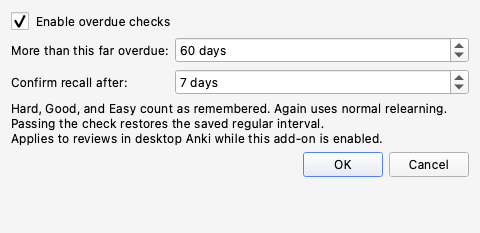
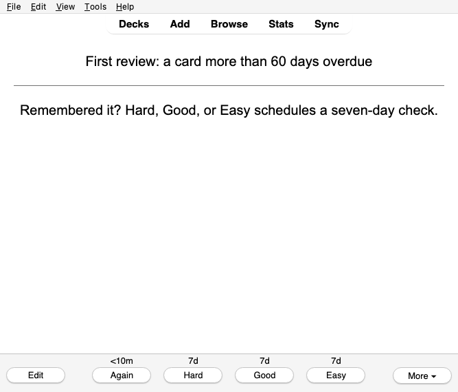
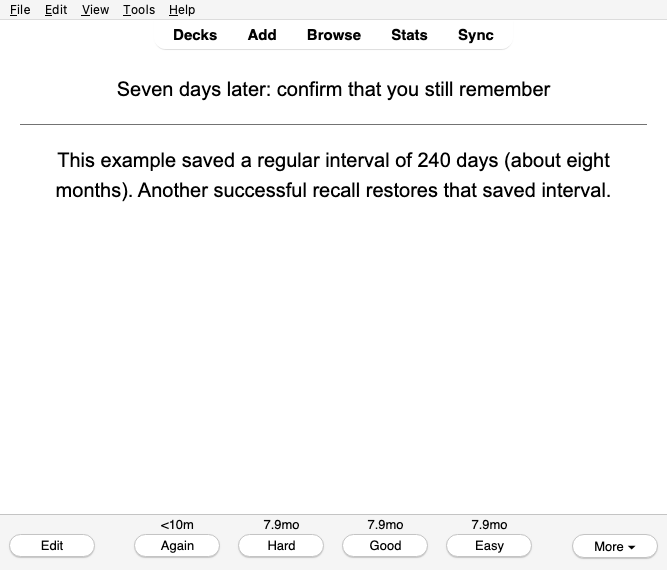

# Overdue Checkpoint

Overdue Checkpoint adds one short follow-up before a very overdue card receives its next long interval. The defaults are more than 60 days overdue and a check seven days after a successful review.

## Install and choose your settings

1. Open desktop Anki 25.09.4.
2. Choose Tools > Add-ons > Get Add-ons.
3. Enter **1501454025** and restart Anki.
4. Open Tools > Overdue Checkpoint settings.



Keep “Enable overdue checks” selected. “More than this far overdue” controls which review cards qualify. “Confirm recall after” controls how long to wait before the extra check. You can change either value.

## What happens when you review

For a qualifying card, Hard, Good, and Easy count as remembered. The add-on saves the interval Anki proposed for the answer you choose, then schedules the card seven days later. The answer buttons show the actual seven-day delay.



When the card returns, recall it before showing the answer and rate it honestly. Another successful recall completes the check. The saved regular interval is restored, or Anki's new proposal is used if it is longer.



These screenshots use sample cards. The confirmation screenshot illustrates a saved interval of 240 days, approximately eight months; the two screenshots are separate examples.

Again always uses your deck's normal relearning settings. It also clears the saved long interval, so forgetting the card at the check does not send it back out for eight months.

## The eight-month example

Suppose Anki would schedule the first successful review in eight months:

| Review | What happens |
| --- | --- |
| First Good on a qualifying overdue card | The eight-month proposal is saved. The card returns in seven days. |
| Good at the seven-day check; Anki now proposes 18 days | The saved eight-month interval is restored. |
| Good at the seven-day check; Anki now proposes ten months | The new ten-month interval is used. |
| Again at the seven-day check | The saved interval is cleared. Normal relearning applies. |

The restored interval starts on the day you answer the check. If you pass it on January 8 and restore eight months, that interval is counted from January 8.

## How the interval is calculated

Anki first calculates the next interval for each answer using your normal scheduler. Overdue Checkpoint saves the proposal for the answer you actually choose.

At confirmation, it uses this rule:

```text
next interval = min(current deck maximum,
                    max(saved regular interval, Anki's new proposal))
```

With SM-2, Anki's new proposal grows from the card's current interval, which is temporarily seven days. The saved regular interval provides the floor: if the new proposal is 18 days and the saved interval is eight months, the result is eight months.

With FSRS, Anki calculates its new proposal using the card's review history and memory state, including the review after seven days. FSRS stability, difficulty, and real answer ratings are preserved. The same saved-interval floor then applies. This intentionally can produce a longer interval than FSRS's latest proposal.

Your deck's current maximum interval remains the cap. For example, if the saved interval is eight months but you change the maximum to six months before confirmation, the resumed interval is capped at six months.

## Which cards qualify

Overdue means days since the card's due date, using Anki's study-day boundary. The default threshold is strict: a card exactly 60 days overdue keeps normal scheduling; a card 61 days overdue qualifies. This approximates two months rather than counting calendar months.

This check uses Anki's proposed next interval for the answer you choose, rather than the card's previous interval. If the new proposal is seven days or less, that shorter interval stays in place. For example, a card previously scheduled for three days can still get a seven-day check if it is now more than 60 days overdue and Anki proposes a longer interval. New and learning cards are unaffected. Filtered decks with rescheduling enabled are supported; preview-only filtered decks keep their normal behavior.

Reviewing early keeps the original check date. If you miss the check and return late, one successful recall still completes the pending check instead of starting another seven-day cycle.

## Desktop and compatibility

Complete both reviews in desktop Anki with the add-on enabled. Mobile apps and AnkiWeb receive due dates through sync but cannot run this add-on's interval-restoration rule. A review on another client can invalidate the saved checkpoint.

Disabling or removing the add-on leaves existing due dates in place. Subsequent reviews use normal Anki scheduling. Manual rescheduling or bulk FSRS rescheduling can replace a checkpoint date or invalidate its saved interval. Other scheduling add-ons can also affect the result.

Version 0.1.0 was tested on Anki 25.09.4 on macOS with 26 automated tests and native GUI checks under FSRS and SM-2. Other Anki versions, platforms, and combinations with third-party scheduling add-ons have not been tested.

[AnkiWeb listing](https://ankiweb.net/shared/info/1501454025) | [Source archive](overdue-checkpoint-0.1.0-source.zip) | [Report an issue](https://github.com/jsonchen47/anki-overdue-checkpoint/issues)
